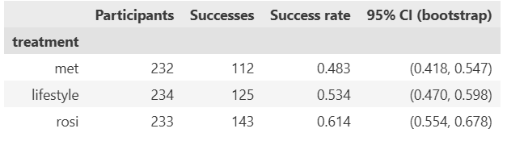
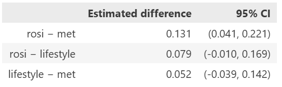

## Lab 6, Part 2 Write Up

**Trial Overview**
 This report reviews a randomized controlled trial that compared three interventions (Met, Rosi, & Lifestyle) for preventing progression from pre-diabetes to diabetes. The dataset contains 699 participants (232 met, 233 rosi, 234 lifestyle), each with a binary outcome of "success" or "failure." The data does not define success, so I will work under the assumption it means the participant did not progress from pre-diabetes to diabetes. Since assignment was randomized, differences in outcomes between arms can be attributed to the interventions themselves rather than to differences in who received them. Uncertainty was addressed with a bootstrap of 10,000 resamples.

**Success rates by treatment** Rosi had the highest observed success rate (at 61.4%), followed by lifestyle (at 53.4%) and lastly met (at 48.3%). From the bootstrap the arms' sampling distributions are approximately symmetric and similar in spread. Rosis distribution is to the right of met's with little overlap, while lifestyle overlaps substantially with both.

**Pairwise comparisons** Only one of the three comparisons is statistically significant. Rosi outperformed met by an estimated 13.1 percentage points (95% CI: 4.1 to 22.1), and the interval excludes zero. Rosi's outperformed lifestyle by 7.9% (95% CI: −1.0 to 17.0) and lifestyle's outperformed met by 5.2% (95% CI: −3.9 to 14.2). Both compatible with no effect, so the trial does not establish a difference for either pair. The rosi vs lifestyle interval only barely included zero, so the data is suggestive of a benefit but do not demonstrate one.

**Conclusions and limitations** The strongest evidence is that rosi is more effective than met at the outcome measured. The evidence that it is better than lifestyle modification is suggestive but inconclusive, and the trial cannot separate lifestyle modification from met. No arm can be described as ineffective since the trial has no untreated control arm, so these results speak only to relative effectiveness. 

The confidence intervals are wide (about ±9 points), so moderate differences between lifestyle and the other treatments could exist and go undetected at this sample size. The dataset also contains no information on follow-up duration, adverse events, adherence to treatment, or cost, all of which matter for adoption decisions. 

Statistically, rosi is the recommend treatment for preventing diabetes when you have pre-diabetes, however practically, you should not adopt rosi on efficacy alone. 